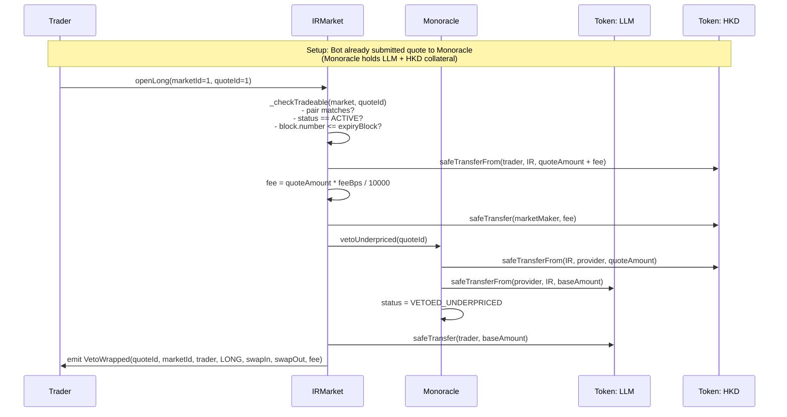
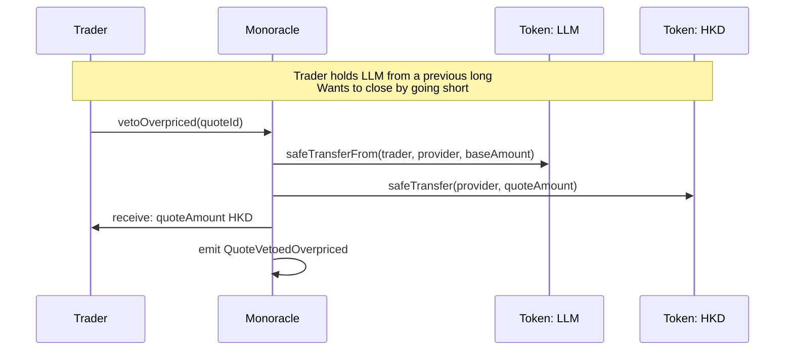
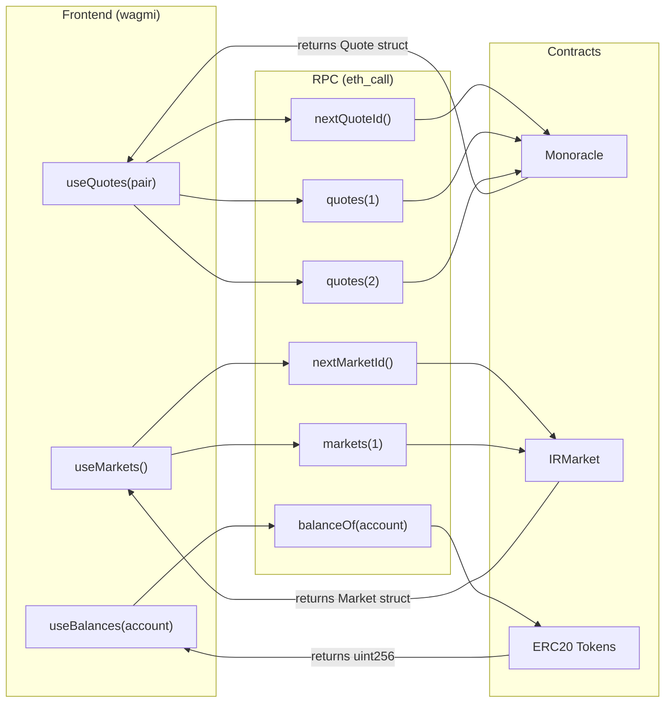

# IRMarket — Architecture Diagram

> How IRMarket contracts interact with upstream Monoracle.

## 1. Architecture Overview

```mermaid
graph TB
    subgraph "Upstream (github.com/dixia/monoracle)"
        M[Monoracle Contract<br/>(immutable, deployed on Monad)]
    end

    subgraph "IRMarket (this repo)"
        IR[IRMarket Wrapper<br/>(thin factory + fee layer)]
        V[IRMarketVault<br/>(one per pair; MVP ships NVDA only)]
        IM[IMonoracle Interface<br/>(type-safe ABI)]
    end

    subgraph "Token Layer"
        LLM[MockERC20: LLM<br/>(base asset)]
        HKD[MockERC20: HKD<br/>(quote asset)]
    end

    subgraph "Actors"
        BOT[Market-Maker Bot<br/>(submits quotes, holds bilateral collateral)]
        TRADER[Trader Wallet<br/>(long / short via veto, or openPosition in vault)]
        LP[LP Wallet<br/>(deposits HKD into the PAIR'S vault)]
        FE[Next.js Frontend<br/>(wagmi + tanstack query)]
    end

    IR -->|"immutable oracle binding"| M
    V -->|"immutable oracle + pair (priceBase, settlementToken)"| M
    IR -.->|"imports"| IM
    M -.->|"implements"| IM

    LP -->|"deposit/withdraw: HKD only"| V
    V -->|"openPosition / settlePosition<br/>read getLatestPrice"| M
    V -->|"pays payout from balance (HKD)"| HKD

    BOT -->|"submitQuote(LLM, HKD, baseAmt, quoteAmt, expiryBlock)"| M
    BOT -->|"approve(LLM, HKD)"| M
    M -->|"holds collateral"| LLM
    M -->|"holds collateral"| HKD

    TRADER -->|"createMarket(base, quote, MM, expiry, feeBps)"| IR
    TRADER -->|"openLong(marketId, quoteId)"| IR
    TRADER -->|"openShort(marketId, quoteId)"| IR
    TRADER -->|"direct close: vetoUnderpriced / vetoOverpriced"| M

    IR -->|"vetoUnderpriced(quoteId)"| M
    IR -->|"vetoOverpriced(quoteId)"| M
    M -->|"swap tokens"| LLM
    M -->|"swap tokens"| HKD

    FE -->|"eth_call: nextQuoteId, quotes(quoteId), getLatestPrice"| M
    FE -->|"eth_call: markets(marketId)"| IR
    FE -->|"eth_call: equity(), shares(), positions()"| V
    FE -->|"read MarketCreated, VetoWrapped, QuoteSubmitted"| M

    style M fill:#4CAF50,color:#fff
    style IR fill:#2196F3,color:#fff
    style V fill:#3F51B5,color:#fff
    style IM fill:#90CAF9,color:#000
    style LLM fill:#FF9800,color:#fff
    style HKD fill:#FF9800,color:#fff
    style BOT fill:#9C27B0,color:#fff
    style TRADER fill:#F44336,color:#fff
    style FE fill:#00BCD4,color:#fff
```

## 2. Call Flow: Open Long (Wrapper Path)



## 3. Call Flow: Direct Close (No Fee)



## 4. Data Flow: Frontend Reads



## 5. Vault Lifecycle (LP-pool MVP — pool is the counterparty)

```mermaid
sequenceDiagram
    participant LP as LP
    participant T as Trader
    participant V as IRMarketVault
    participant M as Monoracle
    participant HKD as Token: HKD

    LP->>V: deposit(amount HKD)
    V->>HKD: safeTransferFrom(LP, V, amount)
    Note over V: shares 1:1 on first seed; balance += amount

    T->>V: openPosition(side, deposit D, tenor)
    V->>M: getLatestPrice(priceBase, settlementToken) → entry S0
    V->>HKD: safeTransferFrom(T, V, D)
    Note over V: fee = 1%; notional N = D − fee;<br/>reserve maxPayout = 2N in pendingPayout<br/>INVARIANT: pendingPayout ≤ balance (never insolvent)

    Note over T,HKD: after expiryBlock (tenor blocks later) — the mark is canonical<br/>automatically once block.number > expiryBlock (lazy settlement; no settle tx)

    T->>V: settlePosition(positionId)   — permissionless, payout → owner
    V->>M: getLatestPrice(...) → settle S
    Note over V,M: getLatestPrice returns the canonical price at read time (newest<br/>matured valid quote); the bot's settleValidQuote is an OPTIONAL checkpoint, never a gate
    Note over V: pnl = N·(S−S0)/S0 (LONG), mirrored SHORT,<br/>capped to [−N, +N] → payout ∈ [0, 2N]
    V->>HKD: safeTransfer(owner, payout)
    Note over V: payout ≥ premium ⇒ trader profit cuts LP equity;<br/>payout ≤ premium ⇒ trader loss stays in vault = LP profit<br/>NEVER any post-hoc fund collection anywhere

    LP->>V: withdraw(shares)
    V->>HKD: safeTransfer(LP, shares × equity / supply)
```

Key invariant of the money design: **every participant's maximum loss is escrowed at
entry** (trader premium pulled in full on open; bot locks bilateral collateral on
`submitQuote`). Settlement therefore only *redistributes already-locked money* — there is
no step anywhere in the lifecycle that "collects a loser's debt to pay a winner"
(that is what margin/liquidation systems do, and this design deliberately has none).
`settlePosition` is permissionless but always pays the position owner: settling is a
gas/incentive question, never a debt question. MVP caveat: the *call-time* mark makes
settlement effectively American (accepted, spec §1.4; V1 pins it to the expiry window §9.3).

## 6. Key Design Points

| Aspect | Detail |
|--------|--------|
| **IRMarket role** | Thin factory + 1% fee wrapper. Does NOT price, match, settle, or hold pools. Holds ZERO user funds at rest (pull-and-forward inside one tx). |
| **Monoracle role** | Trading venue + price source. Quotes carry bilateral collateral (locked at `submitQuote`, both legs). Veto = trade. Canonical price = mark. |
| **IRMarketVault role** | One vault per pair; single-asset: custodies ONLY the settlement token (HKD); `priceBase` is just the pair key for reads, never held |
| **Long = vetoUnderpriced** | Trader pays HKD (quote), receives LLM (base). Bot sold LLM too cheap. |
| **Short = vetoOverpriced** | Trader pays LLM (base), receives HKD (quote). Bot sold LLM too expensive. |
| **Vault LONG/SHORT** | Premium in HKD; capped-linear in HKD; pool absorbs/trades around the capped PnL |
| **Fee** | Always in HKD (quote/settlement token). Charged on open only (wrapper: 1% to marketMaker; vault: 1% retained by pool). |
| **No fork** | IRMarket uses upstream Monoracle directly via `IMonoracle` interface. No vendored oracle code. |

### Hard rules (do not violate when touching deploy/web/scripts)

1. **Consume, never deploy the upstream oracle.** IRMarket-side deploy scripts must take
   `ORACLE_ADDRESS` as an input and gate on the upstream "A" fingerprint — never compile/deploy
   Monoracle from these scripts (see `script/oracle-doctor.js`; renamed consumer-mode script:
   `script/deploy-market-stack.js`).
2. **Oracle binding is immutable ⇒ oracle change = downstream redeploy.** The wrapper/vault pin
   `oracle` at construction; to move to another instance, redeploy the wrapper/vault against the
   consumed address — never bend the ABI or the deployed oracle.
3. **Test tokens are a registry, not a per-demo deploy.** `deployment-assets.json` is the token
   book (per-symbol base tokens + HKD). Reuse by symbol (mint top-ups as needed,
   `script/mint-demo-tokens.js`); deploying fresh tokens is a `--fresh-tokens` escape hatch, not
   the path.
4. **Two semantics never mix** (PRD): V0.9 veto-market (wrapper; Monoracle = venue) and the LP
   vault MVP (Monoracle = price only, vault = counterparty) are two separate product surfaces on
   the same pair — keep them in separate positions/pages, and never let the vault settle against
   quotes submitted by the vault operator itself.

## 7. Product direction: per-pair vault model (documented 2026-10-15 — target, NOT yet deployed)

The confirmed roadmap for how IRMarket composes with upstream Monoracle:

1. **Monoracle stays permissionless.** Anyone with a wallet and collateral can `submitQuote` for
   any pair; anyone can arbitrage-veto or settle. IRMarket never restricts the oracle world.
2. **IRMarket curates.** The product surfaces a **selected set of pairs** for option trading
   (frontend-only registry for now: `NEXT_PUBLIC_SELECTED_BASE_TOKENS` + `deployment-assets.json`;
   the wrapper stays permissionless). Other pairs continue to exist for anyone else.
3. **One vault per selected pair.** Each curated pair `(base_i, HKD)` gets its own
   `IRMarketVault(oracle, base_i, HKD)`; LP deposits go **only into that pair's vault** and take
   counterparty risk for that pair only. MVP ships exactly one (NVDA); the model extends to N by
   deploying more (each vault is cheap; isolation is the point — spec §3, LP-01).
4. **Flow per pair:** seed LPs deposit HKD → bot (a vault operator may also run one) submits
   oracle quotes → traders open veto-trades on the wrapper and/or capped-linear positions on the
   pair's vault → expiry settles at Monoracle canonical price → upgrade of the consumed oracle =
   scripted downstream redeploy.
